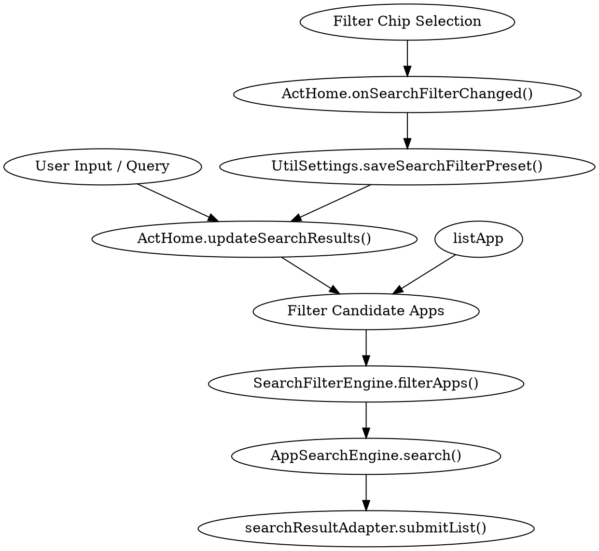

# Design Spec: SEARCH-009 — Bộ lọc tìm kiếm lưu sẵn (Preset Search Filters)

## 1. Context & User Intent

Ứng dụng Launcher hiện có tính năng tìm kiếm offline nhanh (`AppSearchEngine`), hỗ trợ nhiều lens (`FISH-008`), tập app riêng theo lens (`FISH-021`), favorites trong Room DB, và tạm ẩn app khỏi lens (`FEAT-011`).
Tuy nhiên, màn hình tìm kiếm (`SearchView` trong `ActHome`) luôn tìm kiếm trên toàn bộ ứng dụng cài đặt (`listApp`), chưa cho phép người dùng lọc nhanh kết quả theo ngữ cảnh mong muốn.

**Mục tiêu SEARCH-009:** Cung cấp thanh bộ lọc nhanh dạng Chip ngang ngay dưới thanh tìm kiếm, cho phép chuyển đổi tức thì giữa:
1. **Tất cả (All)**: Mặc định, tìm trên toàn bộ app.
2. **Lens này (This Lens)**: Chỉ tìm trong các app thuộc phạm vi hiển thị của Lens đang active (tôn trọng cả app selection và tạm ẩn của lens đó).
3. **Yêu thích (Favorites)**: Chỉ tìm trong danh sách các app được đánh dấu Favorite trong Room DB.
4. **Đã ẩn (Hidden)**: Tìm trong danh sách các app đang bị tạm ẩn khỏi Lens hiện tại (FEAT-011).

Người dùng chọn nhớ bộ lọc đã chọn qua `SharedPreferences`, giúp trải nghiệm tìm kiếm lặp lại liền mạch.

---

## 2. Requirements & Constraints

1. **Preset Filters (Enum `SearchFilterPreset`):**
   - `ALL`: Mặc định, tìm trên toàn bộ `listApp` (như hiện tại).
   - `THIS_LENS`: Lọc theo `scopedApps(currentLensId)` của lens đang hiển thị.
   - `FAVORITES`: Lọc theo các app có `isFavorite == true`.
   - `HIDDEN`: Lọc theo các app có `identifier` nằm trong `getLensHiddenAppIds(currentLensId)`.
2. **UI & Placement:**
   - Đặt ngay đầu `SearchView` (trên `quickActionRow` và `rvSearchResults`).
   - Dùng `HorizontalScrollView` + `ChipGroup` (singleSelection = true, selectionRequired = true) với Material 3 Filter Chips.
   - Mỗi Chip có icon vector tương ứng + nhãn ngôn ngữ:
     - `ALL`: icon `ic_apps_24dp`
     - `THIS_LENS`: icon `ic_color_lens_24dp`
     - `FAVORITES`: icon `ic_favorite_24dp` (hoặc `ic_star_24dp`)
     - `HIDDEN`: icon `ic_visibility_off_24dp`
   - Đầy đủ 17 ngôn ngữ được hỗ trợ trong dự án (`values*/strings.xml`).
3. **Persistence:**
   - Lưu preset đã chọn vào `UtilSettings.KEY_SEARCH_FILTER_PRESET` (dạng string enum name).
   - Khi mở lại `SearchView`, khôi phục preset đã lưu và cập nhật UI Chip checked tương ứng.
4. **Behavior with Empty Query:**
   - Khi query rỗng, danh sách hiển thị (Recent apps hoặc All apps fallback) cũng được áp dụng bộ lọc đã chọn.
5. **No Network / Pure Local:**
   - Bộ lọc hoạt động hoàn toàn offline, 0 network call, 0 thêm thư viện bên ngoài.
6. **Device Policy:**
   - Chỉ thao tác và kiểm thử trên **TECNO BG6 `118743744X002560`**.

---

## 3. Architecture & Data Flow

### Components:
- **`model/SearchFilterPreset.kt` (mới):**
  - Enum gồm: `ALL`, `THIS_LENS`, `FAVORITES`, `HIDDEN`.
  - Hàm tiện ích `fromStored(name: String?): SearchFilterPreset`.
- **`search/SearchFilterEngine.kt` (mới, pure function):**
  - Hàm `filterCandidates(apps: List<App>, preset: SearchFilterPreset, lensApps: List<App>?, hiddenIds: Set<String>): List<App>`
  - Thuần túy logic, không phụ thuộc Android Views hay Context, dễ dàng viết Unit Test độc lập.
- **`util/UtilSettings.kt` (mở rộng):**
  - `KEY_SEARCH_FILTER_PRESET = "search_filter_preset"`
  - `getSearchFilterPreset(): SearchFilterPreset`
  - `saveSearchFilterPreset(preset: SearchFilterPreset)`
- **`res/layout/act_home.xml` (mở rộng):**
  - Thêm `HorizontalScrollView` chứa `ChipGroup` (`filterChipGroup`) ngay trên `quickActionRow`.
- **`ui/ActHome.java` (mở rộng):**
  - Khởi tạo listener cho `filterChipGroup`.
  - Khôi phục checked chip từ `UtilSettings`.
  - Áp dụng `SearchFilterEngine.filterCandidates()` trước khi gọi `AppSearchEngine.search()`.

---

## 4. Verification Plan

1. **Unit Tests (Robolectric / JUnit4):**
   - `SearchFilterPresetTest`: Kiểm tra chuyển đổi từ chuỗi lưu trữ, fallback `ALL` an toàn.
   - `SearchFilterEngineTest`: Kiểm tra lọc tập ứng dụng với từng preset:
     - `ALL`: trả về nguyên danh sách.
     - `THIS_LENS`: chỉ trả về app thuộc lens truyền vào.
     - `FAVORITES`: chỉ trả về app có `isFavorite == true`.
     - `HIDDEN`: chỉ trả về app có ID nằm trong `hiddenIds`.
     - Kết hợp với danh sách rỗng / ID không tồn tại.
   - `UtilSettingsSearchFilterTest`: Lưu/đọc preset từ SharedPreferences.
2. **Widget Tests (`ActHomeSearchFilterWidgetTest.kt`):**
   - Mở SearchView -> kiểm tra hiển thị 4 Filter Chips với đúng icon và text.
   - Chạm vào Chip 'Favorites' -> danh sách tìm kiếm chỉ hiện app Favorite.
   - Chạm vào Chip 'This Lens' -> chỉ hiện app thuộc lens.
   - Chạm vào Chip 'Hidden' -> chỉ hiện app bị ẩn khỏi lens.
   - Kiểm tra persistence: chọn chip, recreate Activity / close & reopen search -> chip đã chọn được khôi phục.
3. **Strings Test:**
   - `SearchFilterStringsTest`: Đảm bảo 4 nhãn bộ lọc được dịch đầy đủ ở tất cả 17 locales.
4. **On-Device Smoke (TECNO BG6 `118743744X002560`):**
   - Mở màn hình tìm kiếm trên máy thật.
   - Kiểm tra thanh Chip cuộn ngang mượt mà, đổi filter xem kết quả cập nhật ngay lập tức.
   - Đóng và mở lại tìm kiếm, xác nhận chip được giữ nguyên.
